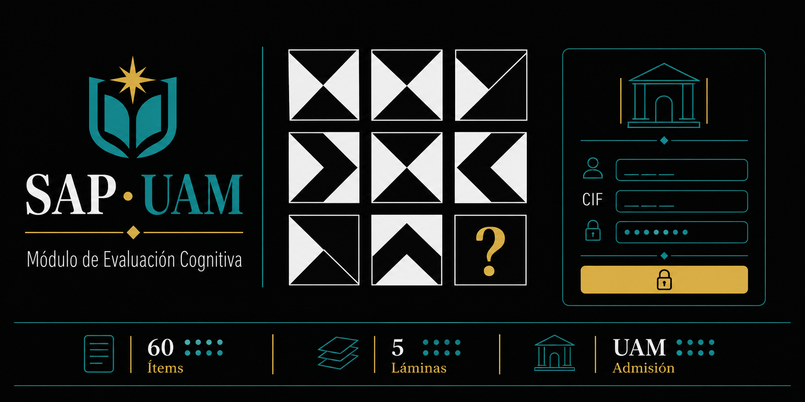

# SAP-UAM · Plataforma de evaluaciones



Plataforma web institucional de evaluaciones para la Universidad Americana (UAM), Nicaragua. La primera evaluación integrada es el **Test de Inteligencia No Verbal de Weil**. Permite acceso mediante credenciales Moodle UAM o cuenta externa y conserva las reglas de aplicación y calificación existentes.

## Stack

| Capa | Tecnología |
|------|-----------|
| Frontend | HTML, CSS y JavaScript vanilla |
| Backend | Spring Boot 3.3.5 · Java 17 · Spring Security · JPA |
| Base de datos | H2 (desarrollo) · PostgreSQL (producción) |
| Autenticación | JWT propio · integración Moodle server-to-server |

## Estructura

```
sap-uam-weil/
├── frontend/
│   ├── index.html
│   ├── app.js
│   ├── test-catalog.js
│   ├── styles.css
│   └── assets/
└── backend/
    ├── pom.xml
    ├── src/main/java/ni/edu/uam/campusfood/
    └── src/main/resources/application.yml
```

## Arquitectura

La solución evoluciona como un monolito modular: identidad, catálogo, aplicaciones, calificación y reportes tienen límites explícitos, pero comparten un único despliegue. La definición de Weil ya está separada del shell de la plataforma mediante un catálogo versionado.

Ver [docs/architecture.md](docs/architecture.md) para el modelo de dominio, contratos, API objetivo y plan de migración del cálculo al backend.

## Ejecutar en desarrollo

**Frontend**
```bash
cd frontend
npx serve . -l 8765
# → http://localhost:8765
```

**Backend**
```bash
cd backend
mvn spring-boot:run
# → http://localhost:8080
```

## API de autenticación

| Método | Endpoint | Descripción |
|--------|----------|-------------|
| POST | `/api/auth/moodle-login` | Login con CIF + contraseña UAM |
| POST | `/api/auth/register` | Registro de cuenta externa |
| POST | `/api/auth/login` | Login manual (correo + contraseña) |
| GET | `/api/auth/me` | Sesión activa |
| POST | `/api/auth/logout` | Cierra sesión |

> La contraseña de Moodle y el token de Moodle **nunca se persisten** en base de datos.

## Respuesta por arrastre

Cada ítem se responde como un rompecabezas: la figura trae un hueco y las 8 opciones son piezas
sueltas que se arrastran hasta él (con ratón o con el dedo). También se puede tocar una pieza, usar
las teclas 1 a 8, o sacar la pieza del hueco arrastrándola afuera. Arrastrar la pieza N equivale a
responder la opción N, así que la calificación y el servidor no cambian.

Las piezas se generan a partir de las láminas completas (`frontend/assets/weill-pages`):

```bash
pip install opencv-python-headless numpy
python3 tools/build_puzzle_assets.py              # regenera frontend/assets/weill-puzzle y puzzle-data.js
python3 tools/build_puzzle_assets.py --dry-run --debug /tmp/debug   # solo detecta y dibuja lo encontrado
```

Si un ítem no tiene piezas, la pantalla vuelve al teclado numérico de siempre.

## Tests

```bash
cd backend && mvn test      # backend
npm test                    # frontend (desde la raíz del repositorio)
```
