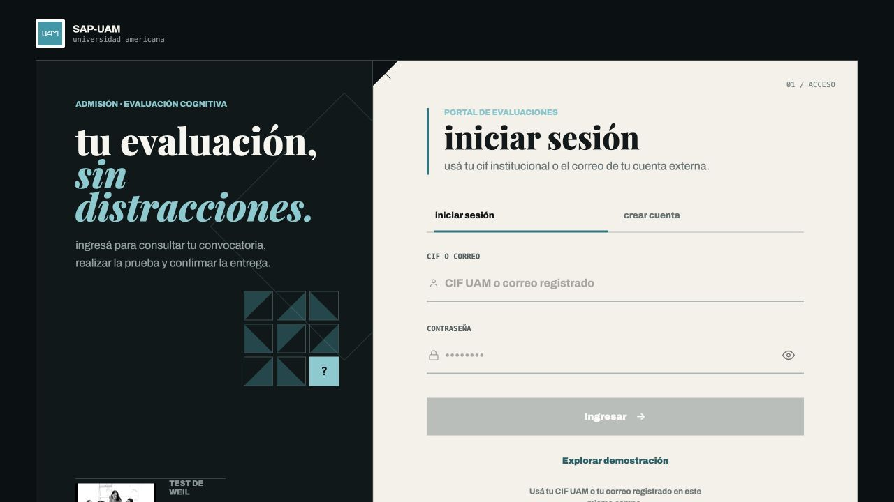
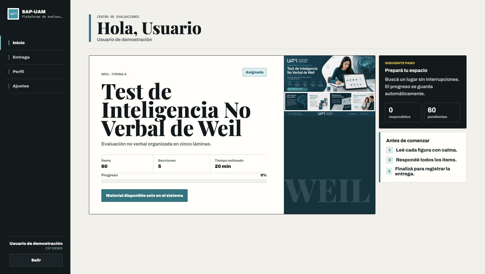

# SAP-UAM · plataforma de evaluaciones

plataforma web institucional para aplicar, administrar y revisar evaluaciones de admisión de la universidad americana (UAM), nicaragua. el primer módulo integrado es el test de inteligencia no verbal de weil, forma a.

el sistema conserva las reglas de aplicación y calificación existentes, pero separa la plataforma compartida de la lógica específica de cada test para poder incorporar nuevas evaluaciones sin duplicar autenticación, administración ni reportes.



## funciones principales

- acceso con credenciales Moodle UAM o cuenta externa.
- roles separados para aspirantes, psicología y administración.
- convocatorias con ventanas de aplicación, códigos de un solo uso y adecuaciones de tiempo.
- intento único con control de concurrencia, límite oficial y recuperación del progreso.
- respuesta por arrastre, toque o teclado, con material protegido por el backend.
- constancia de entrega para el aspirante, sin exponer puntajes ni baremos.
- revisión, invalidación, reaplicación, filtros y exportación CSV para personal autorizado.
- MFA obligatorio, sesiones revocables y auditoría para `STAFF` y `ADMIN`.
- avisos por correo, consentimiento versionado y retención configurable de datos.



## roles

| rol | alcance |
| --- | --- |
| `CLIENTE` | convocatoria, consentimiento, aplicación y constancia de entrega |
| `STAFF` | convocatorias, aspirantes, resultados y baremos |
| `ADMIN` | funciones de `STAFF`, gestión de personal y auditoría |

el aspirante nunca recibe puntaje, percentil, CI, clasificación, claves de respuesta ni motivos internos de invalidación. esa información permanece limitada al personal autorizado.

## arquitectura

SAP-UAM es un monolito modular con límites explícitos entre identidad, catálogo, aplicaciones, calificación, reportes y administración. cada evaluación se registra mediante una definición versionada e inmutable; la interfaz compartida consume ese contrato sin depender directamente del nombre del test.

| patrón | aplicación en el sistema |
| --- | --- |
| lazy load | carga únicamente el material del ítem actual y obtiene detalles de resultados bajo demanda |
| mvc observer | el estado publica eventos específicos para vista, navegación, persistencia y seguridad |
| optimistic lock | detecta escrituras concurrentes mediante versión del intento |
| pessimistic offline lock | reserva un intento activo con arrendamiento renovable y evita sesiones paralelas |
| client session state | conserva respuestas y posición como recuperación local, sin guardar puntajes ni claves |

la calificación y el baremo viven exclusivamente en el backend. el frontend público solo contiene metadatos y geometría necesaria para presentar los ítems.

la documentación completa está en [docs/architecture.md](docs/architecture.md).

## stack

| capa | tecnología |
| --- | --- |
| frontend | HTML, CSS y JavaScript vanilla |
| backend | Java 17, Spring Boot 3.3.5, Spring Security y JPA |
| datos | H2 en desarrollo y PostgreSQL 16 en producción |
| autenticación | sesión JWT propia, integración Moodle server-to-server y TOTP |
| despliegue | Docker, nginx y Docker Compose |

## ejecutar en desarrollo

### frontend

```bash
npm install
npm run serve
```

abre `http://localhost:8765/?demo` para recorrer la interfaz pública. el modo demo no incluye material psicométrico real ni calificación.

### backend

```bash
cd backend
mvn spring-boot:run
```

el backend queda disponible en `http://localhost:8080` con el perfil de desarrollo.

### despliegue completo

```bash
cp .env.example .env
# completar secretos, correo y administrador inicial
docker compose up -d --build
```

las variables requeridas y el procedimiento operativo están documentados en [.env.example](.env.example) y [docs/despliegue-y-operacion.md](docs/despliegue-y-operacion.md).

## pruebas

```bash
npm test
cd backend && mvn test
```

estado verificado: 32 pruebas de frontend y 49 pruebas de integración del backend, incluyendo autenticación, autorización, concurrencia, retención, admisión, resultados y contratos de botones.

## seguridad y privacidad

- la contraseña y el token temporal de Moodle nunca se persisten.
- las claves, baremos y recursos protegidos no forman parte del frontend público.
- cada respuesta se valida y guarda en el servidor mediante operaciones idempotentes.
- la entrega es transaccional y rechaza conflictos de versión.
- desactivar una cuenta, cambiar su rol o restablecer MFA invalida sus sesiones.
- las lecturas y cambios sensibles quedan registrados en auditoría.
- el aviso de privacidad incluido es un borrador pendiente de revisión legal institucional.

## estructura

```text
sap-uam-weil/
├── frontend/        interfaz, catálogo público y pruebas de cliente
├── backend/         API, seguridad, persistencia y calificación
├── deploy/          imagen web y configuración de nginx
├── docs/            arquitectura, despliegue y capturas
├── ops/             respaldo, restauración y PostgreSQL local
└── tools/           generación de piezas y pruebas operativas
```

## documentación

- [arquitectura y patrones](docs/architecture.md)
- [despliegue y operación](docs/despliegue-y-operacion.md)
- [backend](backend/README.md)
