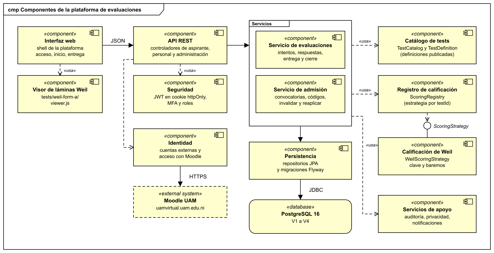
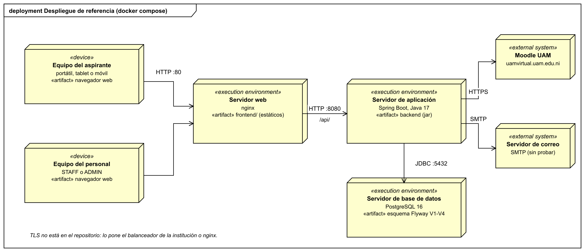
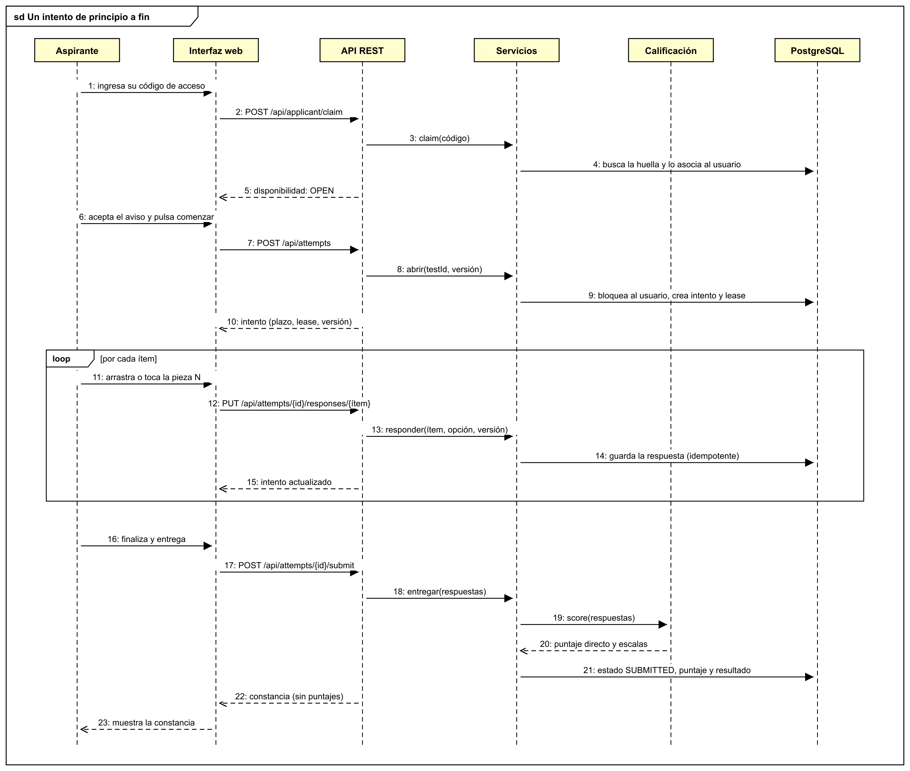
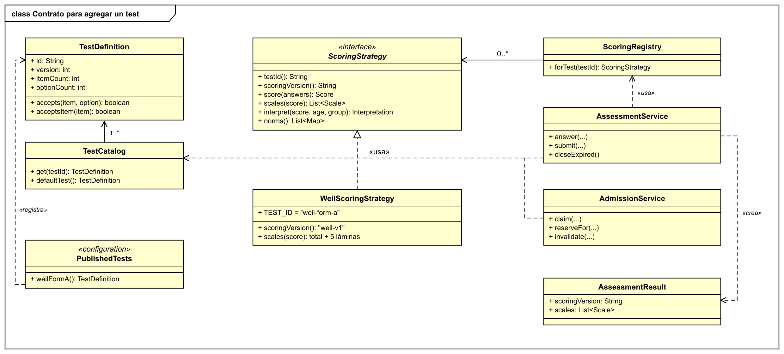
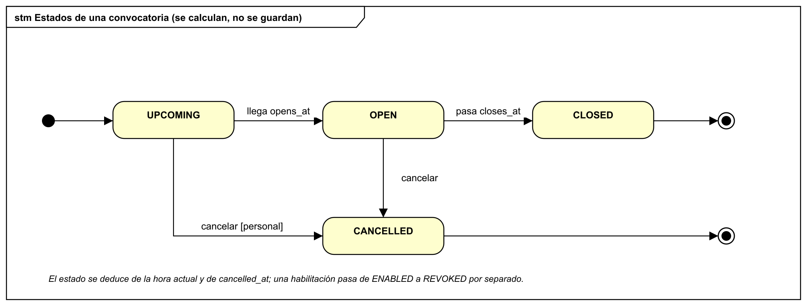
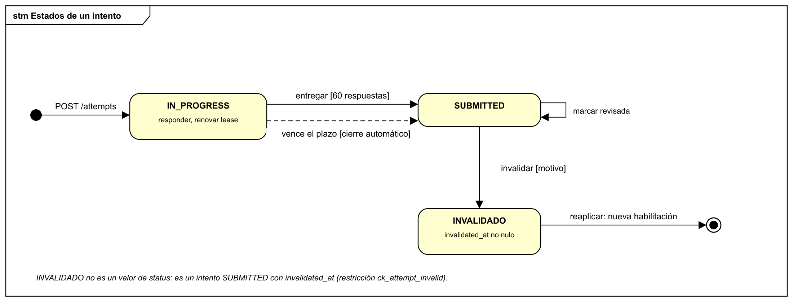
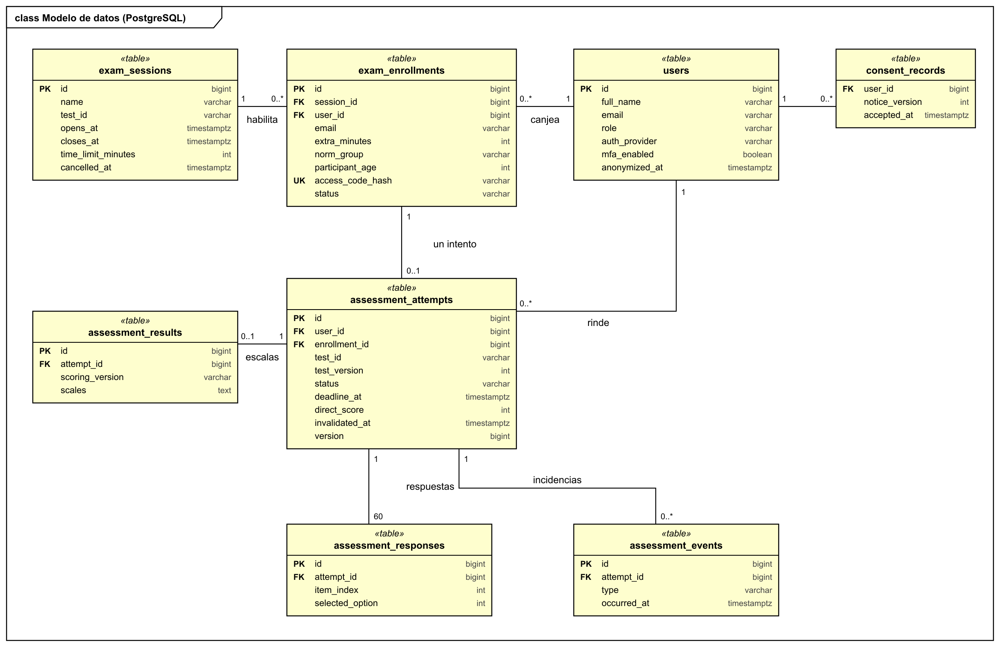
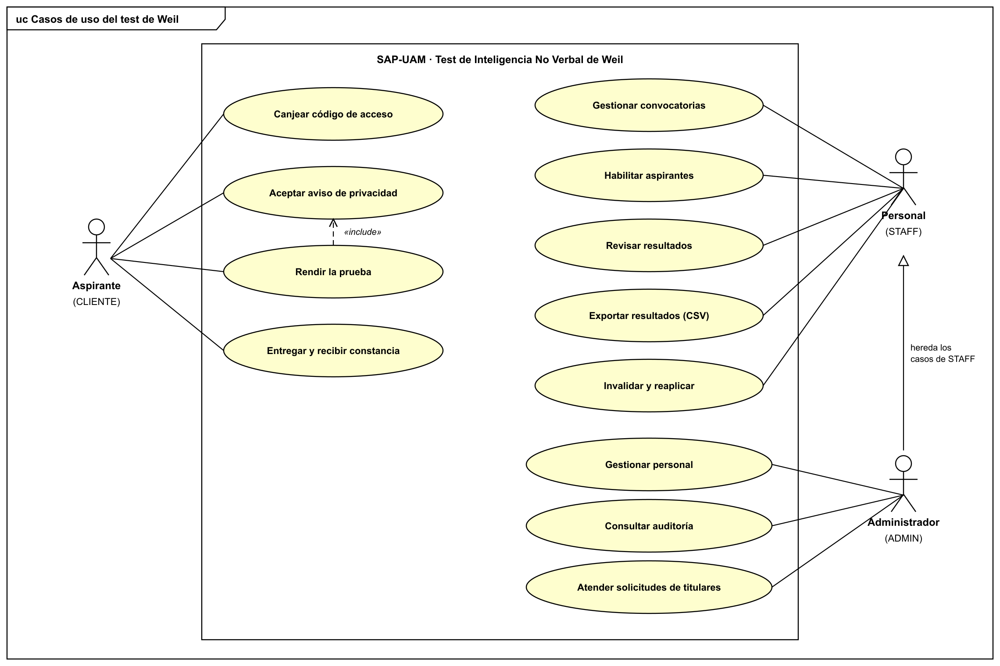

# diagramas del test de weil

diagramas uml en notación de enterprise architect: marco con tipo y nombre (`cmp`, `deployment`, `sd`, `class`, `stm`, `uc`), estereotipos entre « », interfaces, mensajes numerados y modelado de datos con `«table»`. salen del código actual.

| diagrama | archivo |
| --- | --- |
| componentes | [01-componentes.png](01-componentes.png) |
| despliegue | [02-despliegue.png](02-despliegue.png) |
| secuencia de un intento | [03-secuencia-intento.png](03-secuencia-intento.png) |
| clases: contrato para agregar un test | [04-clases-contrato.png](04-clases-contrato.png) |
| estados de una convocatoria | [05-estados-convocatoria.png](05-estados-convocatoria.png) |
| estados de un intento | [06-estados-intento.png](06-estados-intento.png) |
| modelo de datos | [07-modelo-de-datos.png](07-modelo-de-datos.png) |
| casos de uso | [08-casos-de-uso.png](08-casos-de-uso.png) |

cada diagrama existe también como `.svg` vectorial.

## componentes



## despliegue



## secuencia de un intento



## clases



la interfaz `ScoringStrategy` corresponde al `TestEvaluator` del plan de desarrollo colaborativo; el renombre queda pendiente de la arquitectura base.

## estados





## modelo de datos



## casos de uso



## regenerar

```bash
python3 docs/diagramas/fuente/generar.py
```

el generador (`fuente/uml.py` y `fuente/generar.py`) dibuja los svg y, si existe `rsvg-convert`, los png. si cambia el código, se edita el generador y se vuelve a correr.
