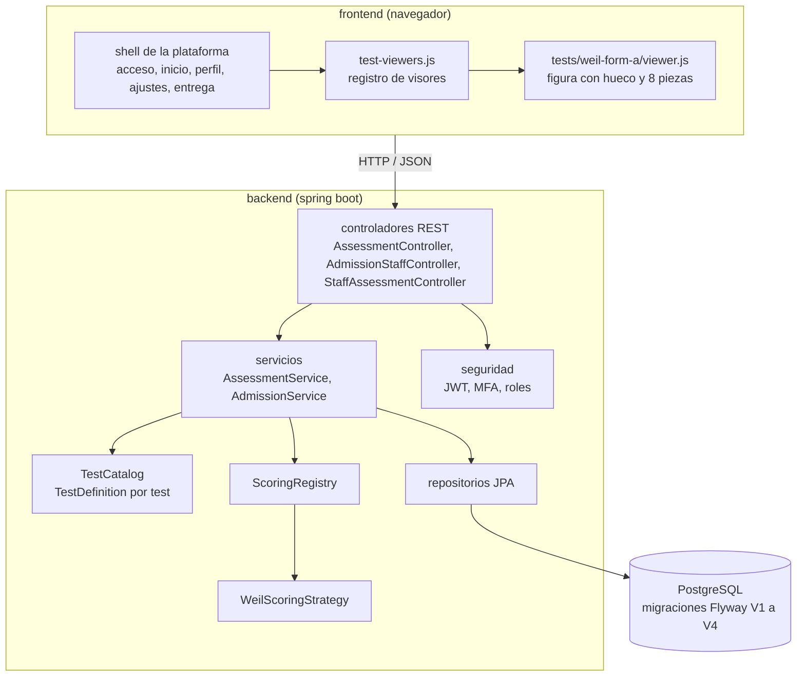
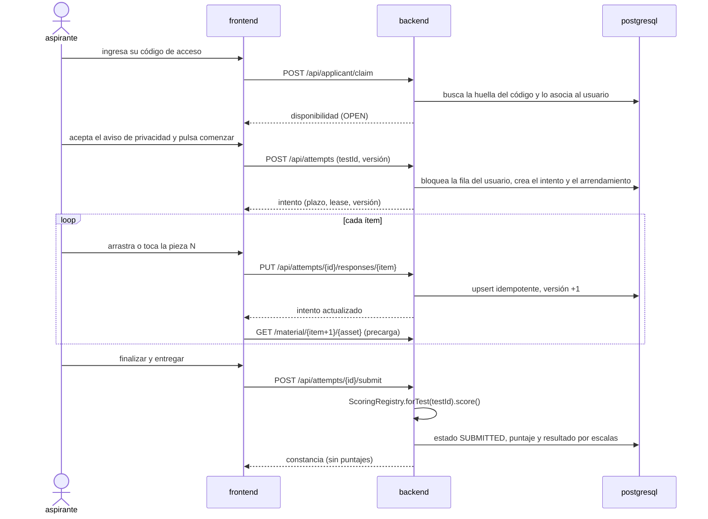
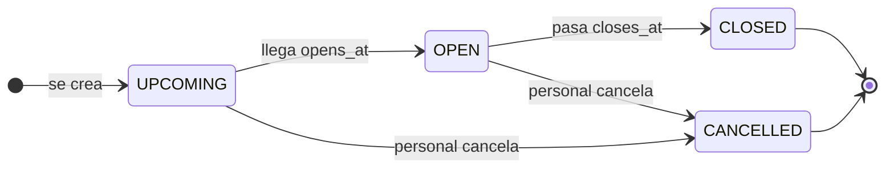
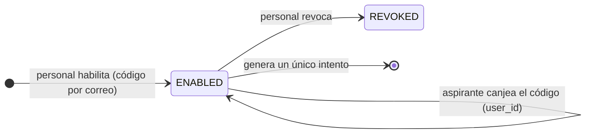
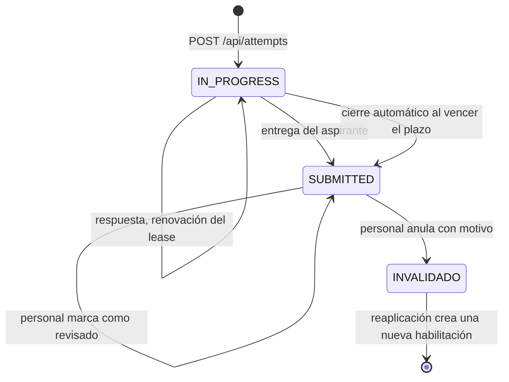
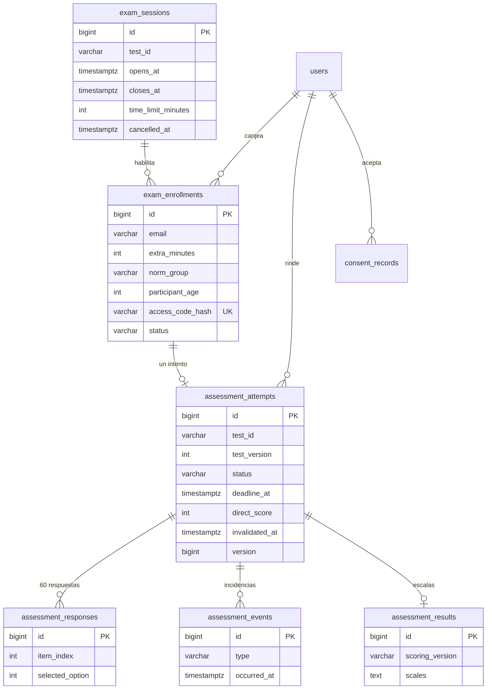
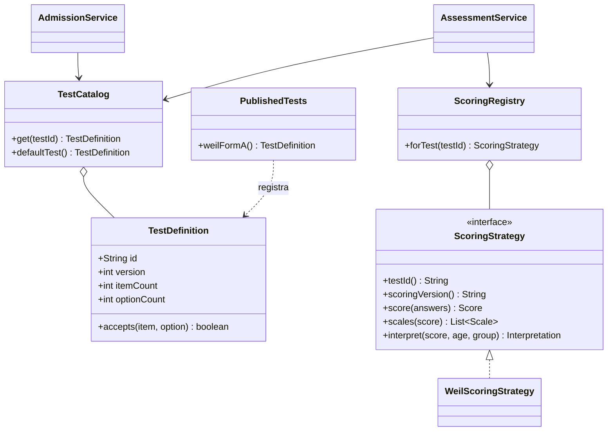

# diagramas del test de weil

diagramas en mermaid, que github renderiza directamente. salen del código actual; si cambia el código, se actualizan aquí.

## 1. contexto y capas

## 2. un intento de principio a fin

## 3. estados de una convocatoria y de una habilitación

el estado de la convocatoria se calcula con la hora actual y `cancelled_at`; no se guarda.

## 4. estados de un intento

`INVALIDADO` no es un valor de `status`: es un intento `SUBMITTED` con `invalidated_at`. la restricción `ck_attempt_invalid` solo permite anular intentos entregados.

## 5. modelo de datos

restricciones relevantes: un intento activo por usuario y test (`uk_attempt_active`), un intento por habilitación (`uk_attempt_enrollment`), una respuesta por ítem (`uk_response_attempt_item`) y un resultado por intento (`uk_result_attempt`).

## 6. contrato para agregar un test

un test nuevo agrega una `TestDefinition` en `PublishedTests`, una implementación de `ScoringStrategy` y, en el frontend, un visor registrado en `SAP_UAM_TEST_VIEWERS`. el plan de desarrollo colaborativo llama `TestEvaluator` a la interfaz; el renombre está pendiente de la arquitectura base.
